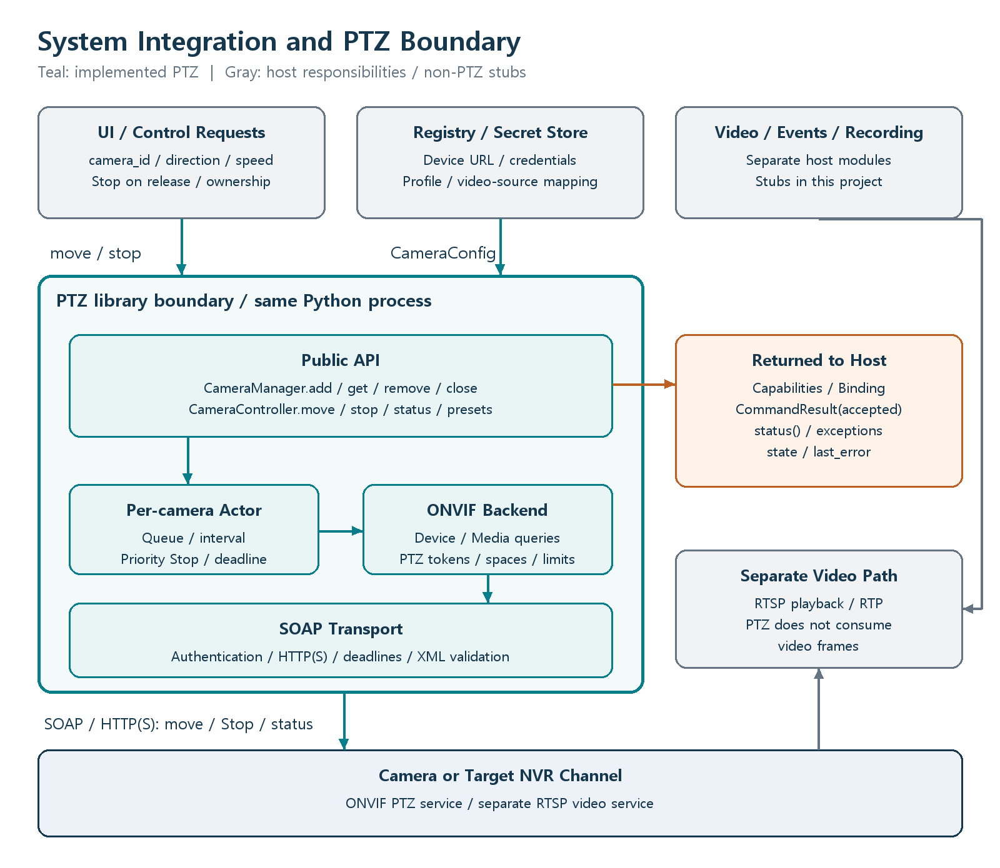

# Python ONVIF PTZ Control

An asynchronous Python library for connecting to and controlling multiple ONVIF PTZ cameras. Targets Python 3.11+. The default mode has no third-party runtime dependencies; optional Zeep mode adds WSDL-backed request serialization.

**Validation status:** Version 0.2.0: 60 tests passed on Windows with Python 3.12.14, Zeep 4.3.3, and a prepared official WSDL bundle. Tests use simulated devices and localhost HTTP. Physical cameras and NVRs have not been tested. This implementation has not completed the official ONVIF conformance process.

## Features

- Device and Media1/Media2 queries, PTZ profile selection, and SOAP authentication.
- Continuous movement, Stop, status, and preset queries; optional position movement and persistent settings.
- Independent per-camera workers, bounded queues, latest pending movement, priority Stop, and time limits.
- Discovery, RTSP playback, event subscriptions, storage, and display remain explicit `not_implemented` stubs.

## System architecture



Video and PTZ share a `camera_id` mapping. The interface is an in-process Python API; it does not include a REST or gRPC server. See [architecture](docs/architecture.md).

## Quick start

Run from the repository root with Python 3.11 or later:

```powershell
python -m unittest discover -v
python -m examples.offline_demo
```

Neither command connects to a physical camera. Some tests start a temporary HTTP server on `127.0.0.1`; the demo uses simulated responses without networking.

To install into another Python project:

```powershell
python -m pip install -e .
```

Setuptools is a build dependency, not a runtime dependency.

Real-device use requires the device's ONVIF URL, credentials, and target profile. **The real-camera example sends Stop during connection and shutdown even without the movement flag.** Read [integration](docs/integration.md) and [safety](docs/safety.md) first.

## Optional Zeep mode (0.2.0)

```powershell
python -m pip install -r requirements-zeep.lock
python -m pip install -e ".[zeep]"
python tools/prepare_wsdl.py --output wsdl_bundle
```

Select `zeep_backend_factory("wsdl_bundle")` when constructing CameraManager.
Installation alone does not switch the default backend. Zeep uses a local WSDL
catalog to serialize requests; the existing transport retains HTTP authentication,
TLS, response limits, and Stop scheduling. See [Zeep setup](docs/zeep.md).

M1 can pass explicit service URLs and consume JSON-ready metadata. See
[integration](docs/integration.md) and [0.2.0 changes](CHANGELOG.md).

## Documentation

- [Architecture and block diagrams](docs/architecture.md)
- [Integration and connection contract](docs/integration.md)
- [Public API and errors](docs/api.md)
- [Concurrency and safety](docs/safety.md)
- [Camera and NVR compatibility](docs/compatibility.md)
- [Standards and implementation rationale](docs/standards.md)
- [Testing and validation limits](docs/testing.md)
- [Zeep setup and limits](docs/zeep.md)
- [Dependencies and licensing](docs/licensing.md)

## License

[MIT](LICENSE). Commercial use of project code is permitted; retain its license notice. Optional dependencies have their own MIT/BSD/Apache/MPL terms; see [third-party notices](THIRD_PARTY_NOTICES.md). See [standards and references](docs/standards.md) for the scope of external reference material.
