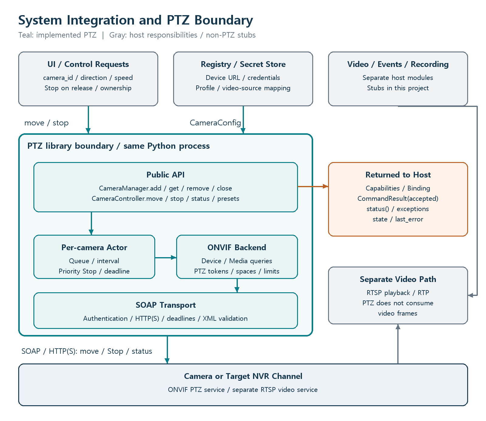
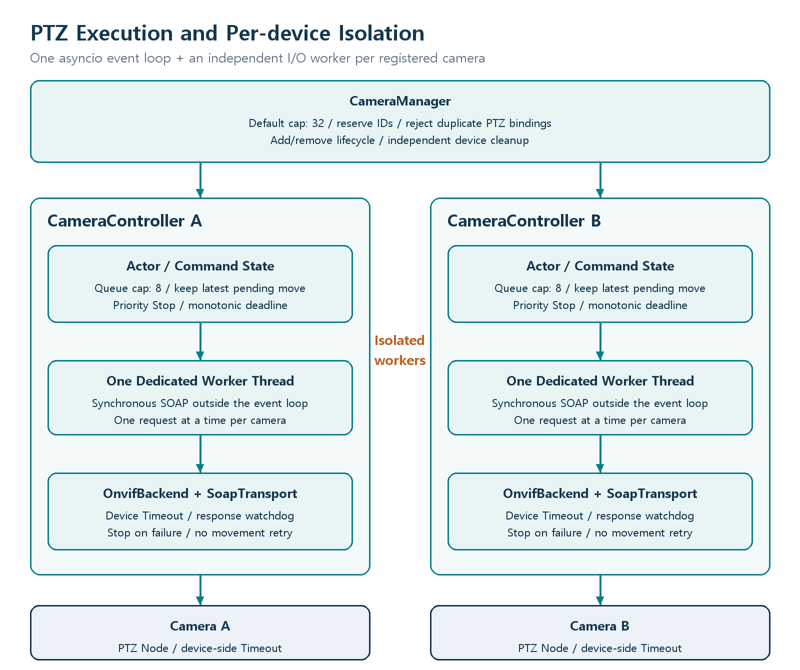

# Architecture and Integration Boundary

[README](../README.md) | [Documentation index](index.md)

## Role in the complete system

The host application supplies device addresses, credentials, video-source mappings, and authorized user commands. This library queries the selected device's PTZ capabilities and performs movement, stopping, and status queries. It integrates with existing device and video modules through a shared `camera_id`.

Teal identifies implemented PTZ components. Gray identifies host responsibilities or non-PTZ stubs. Orange shows returned values; it is not an automatic event bus.

The registry builds `CameraConfig`. The UI or control service looks up a controller by `camera_id` and calls `move()` and `stop()`. The video module maps its RTSP stream to that same identifier. PTZ does not consume video frames, but displayed video and the controlled physical device must match.

`GetServices` and `GetProfiles` are implemented because PTZ initialization needs them. `GetStreamUri`, RTSP/RTP reception, decoding, and recording are outside the implemented scope. The host adapter converts capabilities, status, and exceptions into UI or server responses.

## Execution model

One asyncio event loop manages commands and timers. Each registered camera has an actor and one I/O worker thread for synchronous SOAP operations. A camera waiting on network I/O does not block another camera's event-loop work. Requests to the same camera are serialized.

`CameraManager(max_cameras=32)` defaults to 32 registrations. This is a configurable resource cap, not a benchmarked capacity claim. Each camera requires a worker; active connections also use socket-watchdog timers. Measure OS threads, CPU, network load, and NVR connection limits before increasing capacity.

The manager rejects duplicate `(PTZ XAddr, NodeToken)` registrations before activation Stop. Different host aliases or direct/NVR routes can still identify the same motor. The host must unify those identities and share one controller for the same physical PTZ.

## Other processes or languages

The interface runs in the same Python process. REST, gRPC, message brokers, and GUI integration are not implemented. To expose a separate service, add an adapter before the public API. Serialize `camera_id` and command parameters, keep credentials inside the service, and define user authorization, control ownership, heartbeat behavior, cancellation-to-Stop policy, and status delivery.

## Source layout

| File or directory | Responsibility |
| --- | --- |
| `ptz_control/controller.py` | Manager, queue, ordering, cancellation, timers, lifecycle |
| `ptz_control/backend.py` | Device/Media/PTZ operations, profile binding, spaces and ranges |
| `ptz_control/soap.py` | SOAP XML, UsernameToken, HTTP Digest, TLS, response limits |
| `ptz_control/models.py` | Credentials, configuration, binding, capabilities, results |
| `ptz_control/errors.py` | Public exceptions |
| `ptz_control/stubs.py` | Non-PTZ placeholders |
| `ptz_control/simulation.py` | Offline responses; not the real-device path |
| `examples/` | Offline demo and explicit real-camera example |
| `tests/` | Protocol, local HTTP, concurrency, and failure tests |

The public interface uses `CameraManager.add(CameraConfig)` and `Credentials`. Earlier design names such as `attach_camera` and `credential_ref` are not public APIs in this version.

## 0.2.0 adapter boundary

The existing diagrams remain the high-level execution model. Within SOAP Transport,
optional `ZeepSoapTransport` adds WSDL-based body serialization before the existing
HTTP layer. It does not replace per-camera actors or create a second camera session.
`integration.py` converts local snapshots and XML query results into JSON-ready data.

M1 supplies `service_urls` when advertised service addresses need explicit replacement.
These are namespace-to-URL pairs, not an existing SOAP session. The backend still
queries capabilities and validates the chosen profile; runtime identity and ownership
remain separate. `snapshot()` does not implement MQTT or live health monitoring.
